# Entity Relationship Diagram

```mermaid
erDiagram
    tenants ||--o{ users : has
    tenants ||--o{ animals : owns
    tenants ||--o{ groups : owns
    tenants ||--o{ health_records : records
    tenants ||--o{ mortality_log : records
    tenants ||--o{ breeding_events : records
    tenants ||--o{ suppliers : has
    tenants ||--o{ inventory_items : stocks
    tenants ||--o{ purchase_orders : places
    tenants ||--o{ invoices : issues
    tenants ||--o{ payments : receives
    tenants ||--o{ transactions : "ledger (append-only)"
    tenants ||--o{ budgets : plans
    tenants ||--o{ workers : employs
    tenants ||--o{ notifications : sends
    tenants ||--o{ alert_rules : configures
    tenants ||--o{ audit_log : "audit (append-only)"

    users }o--o{ roles : "user_roles"
    roles }o--o{ permissions : "role_permissions"

    breeds ||--o{ animals : classifies
    groups ||--o{ animals : contains
    groups ||--o{ groups : "parent/child"
    animals ||--o{ animal_group_history : "moved through"
    groups ||--o{ animal_group_history : "movement log"
    animals ||--o{ animal_history_log : "weight/location/ownership"
    animals ||--o{ health_records : "health (append-only)"
    medications ||--o{ health_records : prescribed
    workers ||--o{ health_records : "vet"

    animals ||--o{ mortality_log : dies
    animals ||--o{ breeding_events : "dam/sire"
    breeding_events ||--o{ birth_records : results_in
    birth_records ||--o{ offspring : has
    animals ||--o{ offspring : "new animal"

    inventory_categories ||--o{ inventory_items : groups
    suppliers ||--o{ inventory_items : "preferred supplier"
    suppliers ||--o{ purchase_orders : fulfils
    purchase_orders ||--o{ purchase_order_items : contains
    inventory_items ||--o{ purchase_order_items : ordered
    inventory_items ||--o{ stock_transactions : "in/out (append-only)"

    feed_items ||--o{ stock_movements : "legacy in/out (append-only)"
    feed_items ||--o{ stock_alerts : raises
    feed_items ||--o{ reorder_suggestions : suggests

    invoices ||--o{ invoice_items : contains
    invoices ||--o{ installments : "paid via"
    invoices ||--o{ payments : "settled by (append-only)"
    invoices ||--o{ transactions : "cash movement"

    workers ||--o{ attendance : logs
    workers ||--o{ work_schedules : "shifts"
    workers ||--o{ task_assignments : "assigned"

    users ||--o{ audit_log : acts
    users ||--o{ notifications : receives
    workers ||--o{ alert_rules : "target role"
```

## Notes

- `animals.dam_id` / `animals.sire_id` are self-references (mother / father) enabling lineage.
- `origin` distinguishes `purchased` vs `local` vs `newborn` / `born_on_farm` / `gifted` / `transferred_in`.
- `animal_group_history` is the movement log; `animals.current_group_id` is the fast current-state pointer.
- `group_id` on `animal_group_history` also has a `(tenant_id, id)` composite FK to `groups`.
- `health_records.corrects_id` and `animal_history_log` provide append-only correction/history.
- Mortality insertion updates `animals.status = 'dead'`; one mortality row per animal.
- `birth_records` is one row per breeding event; `offspring` records each calf/lamb/ kid outcome.
- `stock_transactions` is the general-inventory ledger; `stock_movements` remains for legacy feed rows.
- `inventory_categories`, `breeds` and `roles` allow `tenant_id = NULL` for system rows.
- Attendance is manager-entered (`recorded_by`) and worker-acknowledged (`acknowledged_by`).
- Audit, health, payment, transaction, stock and history tables are append-only (trigger-enforced).
- Row-level security is enabled on tenant tables; the app sets `app.tenant_id` per request.
- Full column/constraint detail: `docs/schema.dbml`; required entry fields: `docs/REQUIRED_FIELDS.md`.
